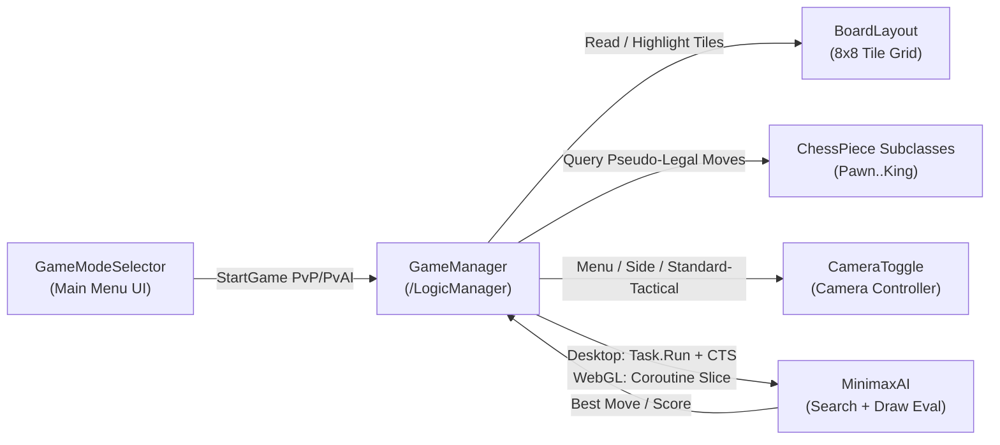

# ProtoChess3D

A 3D chess game built in **Unity (`6000.6.5f1`)** and **C#** supporting both local **Player vs. Player (PvP)** and **Player vs. AI (PvAI)** across Desktop and WebGL.

- **Play in Browser (WebGL):** https://mtgking.itch.io/chessprototype
- **Repository:** https://github.com/MohitMalve07/ProtoChess3D

---

## Features

- **Game Modes:** Local pass-and-play **PvP** and single-player **PvAI** (Human as White vs. AI as Black).
- **Complete Chess Rules:** Legal move filtering (self-check prevention), castling, en passant, auto-promotion to Queen, check/checkmate, stalemate, and automatic insufficient-material draws (`K vs K`, `K+N vs K`, `K+B vs K`, and same-color `K+B vs K+B`).
- **Iterative-Deepening Minimax AI (`MinimaxAI`):** Depth `7` search with a `2500 ms` think budget, alpha-beta pruning, transposition table (`searchGeneration` tagged), move ordering (TT best move, capture scoring, killer moves, and history heuristic), quiescence search, and tapered middlegame/endgame evaluation.
- **Cross-Platform AI Execution:** Runs asynchronously via `Task.Run` with cancellation tokens on multi-threaded targets, and automatically switches to a frame-sliced coroutine (`GetBestMoveCoroutine`, `frameBudgetMs = 15`) on **WebGL** (`UNITY_WEBGL && !UNITY_EDITOR`) so the main thread remains responsive.
- **Clock-Aware AI Draw Evaluation:** Evaluates PvAI draw offers via a fast depth-`3` search (`EvaluatePositionScore`, `250 ms` limit) with time-pressure thresholds and per-turn offer cooldowns.
- **UI & Camera System:**
  - **Main Menu:** Angled 3D showcase camera, **PvP / PvAI** selection, **How To Play** panel, and live directional **Shadows** toggle.
  - **Match HUD:** `15:00` countdown clocks per side, **Undo**, **Resign**, **Draw**, **Standard / Tactical** camera toggle (`Toggle_Text` button or `T` key), 3D piece hover tooltips, and **Quit** (enabled after Resign or accepted Draw) with full board/camera reset back to the Main Menu.

---

## Project Structure

```text
ProtoChess3D/
├── Assets/
│   ├── Scenes/
│   │   ├── Chess.unity                  # Primary playable scene (Main Menu + 3D Board + HUD + LogicManager)
│   │   ├── Chess Complete.unity         # Reference/earlier scene
│   │   ├── AssetTest.unity              # Asset test scene
│   │   └── Prototype.unity              # Early prototype scene
│   ├── Scripts/
│   │   ├── GameManager.cs               # Central match state, input/raycasting, move rules, HUD, clocks, AI orchestration
│   │   ├── MinimaxAI.cs                 # Alpha-beta chess engine, TT, quiescence, coroutine search, draw evaluator
│   │   ├── BoardLayout.cs               # Runtime 8x8 tile grid generator (Tile layer) and tile hover highlight
│   │   ├── CameraToggle.cs              # Smooth Lerp/Slerp camera state machine (Main Menu, White/Black, Standard/Tactical)
│   │   ├── GameModeSelector.cs          # Main Menu panel switching, PvP/PvAI launch, How To Play, Shadows toggle
│   │   ├── ChessAI.cs                   # Experimental Unity Barracuda ONNX inference prototype (inactive/secondary)
│   │   ├── BoardGeneration/
│   │   │   └── ChessBoardGenerator.cs   # Earlier prototype tile generator
│   │   ├── ChessPieces/
│   │   │   ├── ChessPiece.cs            # Abstract base class (PieceColor, PieceType, MoveToSquare, RestoreState)
│   │   │   ├── Pawn.cs                  # Pawn movement, double-push, diagonal capture, en passant
│   │   │   ├── Rook.cs                  # Sliding orthogonal move generation
│   │   │   ├── Knight.cs                # L-jump move generation
│   │   │   ├── Bishop.cs                # Sliding diagonal move generation
│   │   │   ├── Queen.cs                 # Combined rook + bishop rays
│   │   │   └── King.cs                  # Single-step movement + castling eligibility
│   │   └── UI/
│   │       └── ButtonPop.cs             # Pointer-down/up scale feedback on UI buttons
│   ├── Chess_pack/                      # 3D piece prefabs, board frame/assets, textures, UI sprites
│   ├── Materials/                       # Board tile, highlight, hover, and wood materials/textures
│   └── TextMesh Pro/                    # TMP assets & fonts
├── Packages/
│   └── manifest.json                    # Unity packages (uGUI, Barracuda, AI Navigation, Test Framework, Pipeline)
└── ProjectSettings/                     # Unity 6000.6.5f1 editor, build, graphics, and input configuration
```

---

## Architecture

### High-Level Component Diagram



### Core Subsystems

1. **Match Orchestration (`GameManager.cs`)**
   - Maintains board occupancy in `occupiedSquares` (`Dictionary<Vector2, ChessPiece>` keyed by `(col, row)`) and full ply history in `Stack<MoveSnapshot>` for lossless **Undo** and **Quit-to-Menu** board restoration (including captured pieces, castling rooks, `hasMoved`, en passant coordinates, and instantiated promoted queens).
   - Handles 3D raycast selection on `chessPieceLayer` and tile target resolution via `BoardLayout.TryGetBoardCoordinates`.
   - Filters pseudo-legal moves from `ChessPiece.GetLegalMoves()` through `GetValidMovesForPiece()` (temporary simulated moves + king-safety check) and runs `CheckForGameOver()` after each turn.
   - Manages player/opponent countdown clocks, button interactability (`UpdateActionButtons()`), `gameStatusText` auto-sizing, and world-to-UI piece hover tooltips.

2. **Chess Engine & WebGL Search Pipeline (`MinimaxAI.cs`)**
   - Uses an isolated `InternalPiece[8, 8]` value-type snapshot (`BuildInternalBoardSnapshot()`) and `SearchRights` (castling + en passant) so search never touches Unity `GameObject`s or scene state.
   - Implements Zobrist hashing, a `131,072`-entry (`1 << 17`) transposition table (`TTEntry[]`), `NegamaxMinimax` alpha-beta pruning, `Quiesce` search, killer moves, history heuristic, and tapered middlegame/endgame piece-square tables.
   - **Execution modes:**
     - **Multi-threaded platforms:** `RunAIBackgroundSearch` spawns `Task.Run` with a `CancellationTokenSource` checked every `2048` nodes inside `CheckTimeAndCancel`, and `TriggerAIMove()` awaits any previously cancelled `activeAiTask` before reusing `reusableContext`.
     - **WebGL (`UNITY_WEBGL && !UNITY_EDITOR`):** `RunAICoroutineSearch` invokes `GetBestMoveCoroutine`, yielding between root moves whenever `frameBudgetMs` (`15 ms`) elapses and checking a `shouldCancel` state predicate before applying any move.
   - **Draw evaluation:** `EvaluatePositionScore` runs a synchronous depth-`3` search (`250 ms` cap) from Black's perspective. `GameManager.GetAIDrawAcceptThreshold` accepts at `<= +50` cp normally, `<= +150` cp if Black has `< 20 s` left and score `< 500`, and tightens to `<= -200` cp if White has `< 15 s` left.

3. **Scene & Camera Lifecycle (`GameModeSelector.cs`, `CameraToggle.cs`)**
   - At startup, `GameModeSelector.Start()` pauses gameplay (`Time.timeScale = 0f`), initializes shadows off, and displays the Main Menu while `CameraToggle` frames the board from the showcase angle.
   - Selecting **PvP** or **PvAI** triggers `GameManager.StartGame(mode)`, enables `HUDCanvas`, exits the showcase angle, and resumes `Time.timeScale = 1f`.
   - `CameraToggle.Update()` uses `Time.unscaledDeltaTime`, allowing smooth camera transitions back to the showcase pose even when `QuitToMainMenu()` sets `Time.timeScale = 0f`.

---

## Running Locally

1. Open the repository in **Unity `6000.6.5f1`** (or compatible Unity 6 version).
2. Open [Assets/Scenes/Chess.unity](Assets/Scenes/Chess.unity).
3. Press **Play** in the Editor (uses `Task.Run` background AI), or switch target platform to **WebGL** in **Build Profiles / Build Settings** to run with the coroutine AI fallback.
